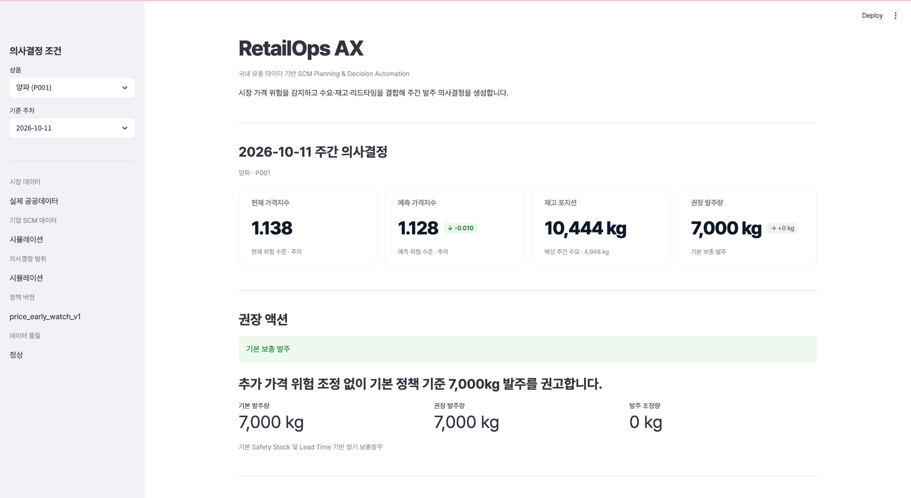
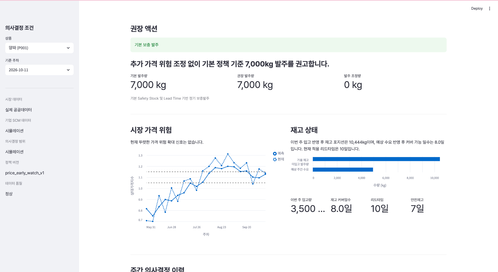
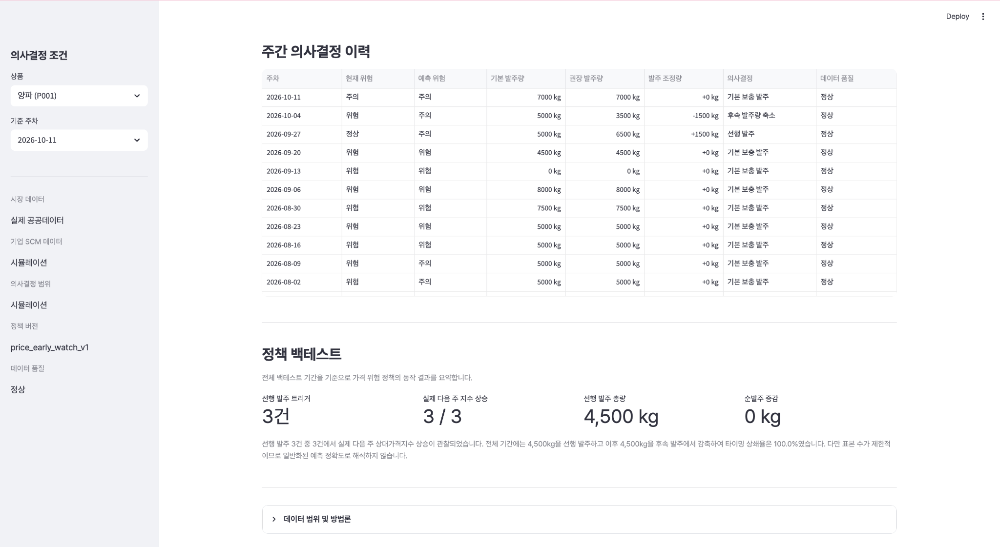
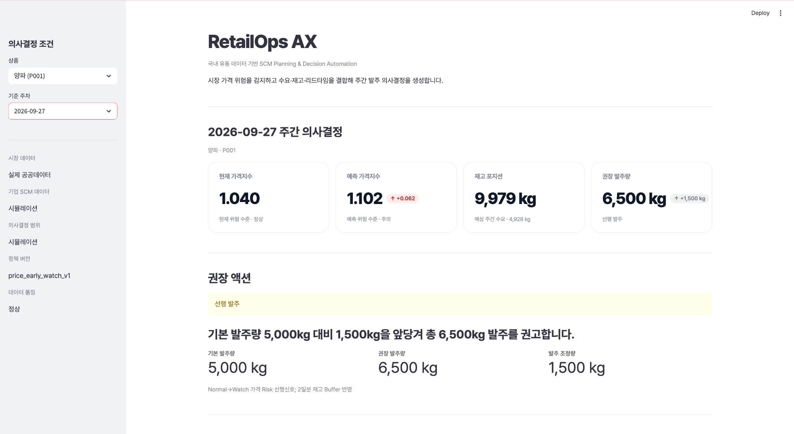
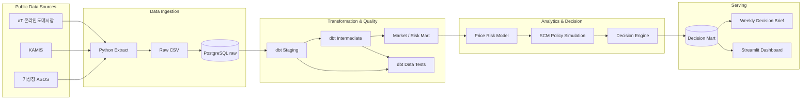
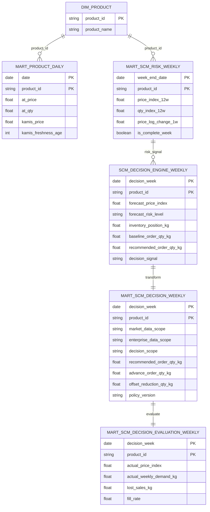

# RetailOps AX

### 국내 유통 데이터 기반 SCM Planning & Decision Automation

국내 유통 공공데이터를 자동 수집/정형화하고, 검증된 **시장 가격 Risk Signal**을 재고/발주 정책과 연결해 **주간 SCM 의사결정까지 자동화한 End-to-End AX 프로젝트**입니다.


## 1) 프로젝트 소개

RetailOps AX는 단순한 가격 예측 프로젝트가 아니라, **시장 데이터를 실제 SCM 발주 의사결정으로 연결하는 운영 흐름 전체를 설계**하는 것을 목표로 했습니다.

| 구분 | 내용 |
|---|---|
| **문제 정의** | 시장 가격 변화와 재고 상태를 사람이 따로 확인한 뒤 발주량을 판단하는 수작업 흐름 |
| **목표** | 시장 Risk 감지 → 재고 정책 결합 → 발주 Timing 조정 → 의사결정 제공까지 자동화 |
| **Pilot SKU** | 양파(P001) |
| **시장 데이터** | aT 온라인도매시장 / KAMIS / 기상청 ASOS |
| **기업 SCM 데이터** | 수요/재고/입고/리드타임 Simulation |
| **주요 산출물** | Decision Mart / Weekly Decision Brief / Streamlit Dashboard |
| **자동화** | API 수집부터 Brief 생성까지 End-to-End Pipeline |

### 📌 기존 업무 흐름 → RetailOps AX

```text
기존
데이터 조회 → 엑셀 정리 → 가격/수급 확인 → 재고 점검 → 발주량 판단 → 보고

RetailOps AX
API 수집 → PostgreSQL → dbt → Risk 예측 → 재고/발주 정책
→ Decision Mart → Weekly Brief / Dashboard
```

### 🧅 Pilot SKU로 양파를 선택한 이유

양파는 국내 공개데이터만으로 **도매가격/거래량 → 소매가격 → 생산지역 기상 Proxy**를 연결할 수 있고, 계절성과 가격 변동성이 존재해 End-to-End SCM 파이프라인을 검증하기에 적합했습니다.

## 2) 핵심 결과

| 구분 | 결과 |
|---|---|
| **Price Risk Model** | Price + Season Ridge 모델이 Naive 대비 MAE 약 **18.7% 개선** |
| **Feature Selection** | Weather Feature는 시계열 검증에서 성능이 악화되어 최종 모델에서 제외 |
| **Inventory Policy** | 서비스 수준과 재고 부담을 비교해 **Safety Stock 7일**을 Working Policy로 사용 |
| **Early Watch Backtest** | 최신 대시보드 기준 선행 발주 Trigger **3건**, 3건 모두 다음 주 상대가격지수 상승 |
| **Order Timing** | 선행 발주 총량 **4,500kg**, 이후 후속 발주에서 상쇄되어 **순발주 증감 0kg** |
| **Pipeline Quality** | Market/Risk dbt **32 PASS**, Decision Mart dbt **20 PASS**, Duplicate Key **0** |
| **Decision Mart** | 54주 Decision / Evaluation 데이터 생성 및 검증 |

## 3) 서비스 소개

Streamlit Dashboard에서 주차별 시장 가격 Risk, 재고 상태, 권장 발주량과 정책 적용 결과를 확인할 수 있습니다.

<table>
  <!-- 1행: 제목 -->
  <tr>
    <td align="center" width="50%">
      <b>주간 의사결정 개요</b>
    </td>
    <td align="center" width="50%">
      <b>시장 가격 위험 / 재고 상태</b>
    </td>
  </tr>

  <!-- 2행: 이미지 -->
  <tr>
    <td align="center">
      
    </td>
    <td align="center">
      
    </td>
  </tr>

  <!-- 3행: 설명 -->
  <tr>
    <td align="center">
      현재/예측 가격지수, 재고 포지션, 권장 발주량과
      최종 액션을 한 화면에서 확인합니다.
    </td>
    <td align="center">
      가격 Risk 추이와 가용재고, 예상수요,
      리드타임, 안전재고를 함께 확인합니다.
    </td>
  </tr>

  <!-- 4행: 제목 -->
  <tr>
    <td align="center">
      <b>의사결정 이력 / 정책 백테스트</b>
    </td>
    <td align="center">
      <b>선행 발주 사례</b>
    </td>
  </tr>

  <!-- 5행: 이미지 -->
  <tr>
    <td align="center">
      
    </td>
    <td align="center">
      
    </td>
  </tr>

  <!-- 6행: 설명 -->
  <tr>
    <td align="center">
      주차별 기본/권장 발주량과 발주 조정 이력,
      정책 Backtest 결과를 확인합니다.
    </td>
    <td align="center">
      2026-09-27 가격 위험이 정상→주의로 전환될 것으로 예측되어
      기본 5,000kg 대비 1,500kg을 앞당겨
      총 6,500kg 발주를 권고한 사례입니다.
    </td>
  </tr>
</table>

## 4) 주요 개발 내용

### 4-1. 아키텍처

공공데이터 수집부터 데이터 모델링, 가격 Risk 예측, SCM 정책 적용, 의사결정 제공까지 하나의 흐름으로 연결했습니다.



### 4-2. ERD

아래는 분석/의사결정 계층의 핵심 테이블 관계를 표현한 **Logical ERD**입니다. 실제 PostgreSQL의 물리 FK 제약을 의미하지는 않습니다.



Decision Mart와 Evaluation Mart를 분리해 **사후 실제값이 의사결정 Input에 유입되는 Leakage를 방지**했습니다.

### 4-3. 기술 스택

#### Data Engineering


#### Analytics / Modeling


#### Visualization / Serving


#### Version Control


## 5) 데이터 및 분석 설계

### 5-1. 데이터 범위

| 구분 | 데이터 | 데이터 소스 / 범위 |
|---|---|---|
| 도매가격/거래량 | aT 온라인도매시장 | [한국농수산식품유통공사 온라인 도매시장 거래정보](https://www.data.go.kr/data/15141811/openapi.do) |
| 소매가격 | KAMIS | [한국농수산식품유통공사 일별 도/소매 가격정보](https://www.data.go.kr/data/15156057/openapi.do) |
| 기상 | 기상청 ASOS | [기상청 지상(종관, ASOS) 일자료 조회서비스](https://www.data.go.kr/data/15059093/openapi.do) |
| 가격 Risk Feature | 시장 데이터 기반 | 위 공개 시장데이터를 활용한 파생 Feature |
| 수요/재고/입고량 | 기업 내부 데이터 대체 | Simulation |
| Lead Time | 기업 내부 데이터 대체 | Simulation |
| Safety Stock | 정책 변수 | Simulation |
| 권장 발주량 | Decision Engine | Simulation |

**수집 데이터**

- **aT 온라인도매시장:** 3,037 rows / 2023-10-16 ~ 2026-10-13
- **KAMIS:** 7,148 rows / 2023-10-16 ~ 2026-10-08
- **기상청 ASOS:** 4,137 rows / 2023-01-01 ~ 2026-10-10

### 5-2. Data Engineering & Quality

```text
API
→ Raw CSV
→ PostgreSQL raw
→ dbt staging
→ dbt intermediate
→ analytical marts
```

dbt 주요 모델:

```text
stg_at_online_trade
stg_kamis_price
stg_kma_asos_weather

int_at_trade_validated
int_at_product_daily
int_kamis_product_daily
int_market_weekly
int_weather_features
int_weather_weekly

mart_product_daily
mart_scm_risk_weekly
mart_scm_decision_weekly
mart_scm_decision_evaluation_weekly
```

aT 거래 데이터는 이상치를 `HARD / REVIEW / OK`로 구분하고, 날짜 전체를 제외하지 않고 **record-level quarantine** 방식으로 관리했습니다.

### 5-3. Price Risk Modeling

다음 주 상대 가격 Risk를 예측해 발주 Timing 조정에 사용할 수 있는지 검증했습니다.

```text
Target = next_price_index
Price Index = 과거 12주 trailing median 대비 상대값
```

시계열 누수를 피하기 위해 Random Split 대신 **TimeSeriesSplit**을 사용했습니다.

- Final Model: Ridge Regression
- Features: `price_index_12w`, `price_log_change_1w`, `season_sin`, `season_cos`

| Model | MAE | RMSE |
|---|---:|---:|
| Naive | 0.0997 | 0.1168 |
| Market Features | 0.0815 | 0.0960 |
| **Price + Season** | **0.0811** | **0.0952** |
| Market + Weather | 0.0960 | 0.1142 |

Weather Feature는 일부 상관관계가 있었지만 시계열 Validation에서 성능을 악화시켜 최종 핵심 Feature에서는 제외했습니다.

### 5-4. SCM Decision Policy

예측값을 바로 발주량으로 변환하지 않고 **Inventory Policy와 Price Risk Policy를 분리**했습니다.

```text
Inventory Policy
Demand + Lead Time + Safety Stock
→ Replenishment

Price Risk Policy
Validated Price Forecast
→ Early Watch
→ Advance Purchase
→ Order Timing Shift
```

Price Risk Buffer:

```text
Normal → Watch    +2 days
Normal → Risk     +4 days
Watch  → Risk     +3 days
그 외              0 days
```

Safety Stock은 0/3/5/7/10일 시나리오를 비교한 뒤, 서비스 수준과 재고 부담의 균형을 보기 위한 **7일 Working Policy**를 사용했습니다.

### 5-5. Decision Mart

`mart_scm_decision_weekly`에는 **의사결정 시점에 알 수 있는 정보만** 포함하고, 실제 결과는 `mart_scm_decision_evaluation_weekly`로 분리했습니다.

```text
Decision Mart
- current / forecast price index
- current / forecast risk level
- inventory position
- forecast demand
- lead time / safety stock / risk buffer
- baseline / recommended order
- decision signal / reason

Evaluation Mart
- actual price index
- actual demand
- lost sales
- fill rate
```

## 6) 자동화 및 산출물

### 6-1. End-to-End Pipeline

전체 Workflow는 한 명령으로 실행할 수 있습니다.

```bash
python scripts/run_pipeline.py
```

API 재수집 없이 기존 Raw Data로 재실행:

```bash
python scripts/run_pipeline.py --skip-extract
```

```text
[1/8] Public Data Extraction
[2/8] PostgreSQL Raw Load
[3/8] dbt Market / Risk Feature Mart
[4/8] Price Risk Model
[5/8] SCM Decision Engine
[6/8] Decision Output PostgreSQL Load
[7/8] dbt Decision Mart Build + Test
[8/8] SCM Brief / Final Validation
```

최종 실행 검증:

```text
Market / Risk dbt Build  PASS=32 / ERROR=0
Decision Mart dbt Build PASS=20 / ERROR=0
Decision Mart           Rows=54 / Unique Weeks=54 / Duplicate Keys=0
PIPELINE COMPLETED SUCCESSFULLY
```

### 6-2. Weekly Decision Brief

Decision Mart를 SCM 담당자가 바로 읽을 수 있는 Markdown Brief로 자동 변환합니다.

```text
시장 가격 위험
→ 현재 / 다음 주 Risk

재고 상태
→ Inventory Position / Forecast Demand / Lead Time

권장 액션
→ Baseline Order
→ Recommended Order
→ Timing Adjustment

Decision Reason
→ 가격 Risk와 재고 정책을 함께 반영한 발주 의사결정 근거
```

### 6-3. Dashboard 실행

```bash
streamlit run app/app.py
```

## 7) 프로젝트 구조

```text
retailops-ax/
├── app/
│   └── app.py
├── docs/
│   └── images/
│       ├── dashboard_overview.png
│       ├── dashboard_action_inventory.png
│       ├── dashboard_history_backtest.png
│       └── dashboard_advance_purchase.png
├── data/
│   ├── raw/
│   └── processed/
├── notebooks/
│   ├── 01_mart_eda.ipynb
│   ├── 02_scm_risk_feature_eda.ipynb
│   ├── 03_risk_model_validation.ipynb
│   ├── 04_scm_decision_simulation.ipynb
│   └── 05_scm_decision_brief.ipynb
├── outputs/
│   └── briefs/
├── retailops_dbt/
│   ├── models/
│   │   ├── staging/
│   │   ├── intermediate/
│   │   └── marts/
│   └── seeds/
├── scripts/
│   └── run_pipeline.py
├── src/
│   ├── extract/
│   └── load/
├── .env.example
├── .gitignore
├── requirements.txt
└── README.md
```

## 8) 설계 판단 및 한계

### 🤔 주요 설계 판단

- **예측 성능보다 Decision 연결을 우선**  
  `Prediction → Risk Signal → Inventory Policy → Order Adjustment → Decision Output` 구조로 설계했습니다.

- **Weather Feature를 억지로 사용하지 않음**  
  데이터가 존재하더라도 시계열 검증에서 성능이 악화되면 최종 모델에서 제외했습니다.

- **Classification 대신 Regression 유지**  
  Risk Event가 특정 기간에 군집되어 있어 연속형 Price Index를 예측하고 운영 Threshold를 별도로 적용했습니다.

- **실제 시장 데이터와 Simulation을 명시적으로 분리**

```text
Market Data      = PUBLIC_ACTUAL
Enterprise Data  = SIMULATED
Decision Scope   = SIMULATION
```

### 💥 Limitations

- Pilot SKU가 양파 1개 품목에 한정
- 기업 실제 POS / Inventory / Purchase Order 데이터 미사용
- Demand Forecast는 Simulation 기반
- 실제 공급계약 가격/MOQ/구매 단위 미반영
- Price Risk Early Watch 사례 수가 제한적
- 생산지 Weather는 농가 단위가 아닌 지역 Station Proxy
- 모델/정책 실행 일부가 Notebook 기반

현재 결과는 실제 기업 운영 성과가 아니라 **SCM Decision Automation Architecture와 Policy Logic을 검증한 PoC**로 해석합니다.

### 🔜 Next Steps

```text
POS / Order History        → 실제 Demand Forecast
On-hand / Inbound / PO     → 실제 Inventory Position
Supplier Lead Time / MOQ   → 실제 Replenishment Policy
Purchase Price / Contract  → 실제 Procurement Cost Evaluation
Multi-SKU                  → Category-level Planning
Scheduler / Orchestration  → Production Pipeline
```