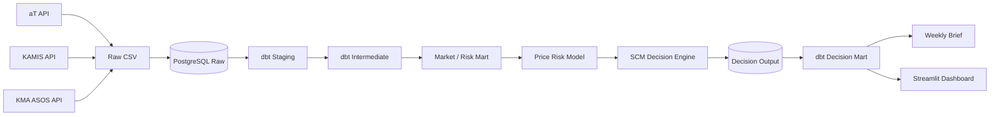

# RetailOps AX

### 국내 유통 데이터 기반 SCM Planning & Decision Automation

국내 유통 공공데이터를 자동 수집·정형화하고, 검증된 **시장 가격 Risk Signal**을 재고·발주 정책과 연결해 **주간 SCM 의사결정까지 자동화한 End-to-End AX 프로젝트**입니다.

> **Public Market Data → PostgreSQL → dbt → Price Risk Model → SCM Decision Engine → Decision Mart → Weekly Brief → Dashboard**

---

## 1. 프로젝트 개요

RetailOps AX는 단순한 가격 예측 프로젝트가 아니라, **시장 데이터를 실제 SCM 의사결정으로 연결하는 운영 흐름 전체를 설계**하는 것을 목표로 했습니다.

```text
기존
데이터 조회 → 엑셀 정리 → 가격/수급 확인 → 재고 점검 → 발주량 판단 → 보고

RetailOps AX
API 수집 → PostgreSQL → dbt → Risk 예측 → 재고·발주 정책 → Decision Mart → Brief / Dashboard
```

핵심 질문은 다음과 같습니다.

> **시장 가격이 오를 가능성을 미리 감지했을 때, SCM 담당자의 발주 의사결정은 어떻게 달라져야 하는가?**

---

## 2. Pilot SKU — 양파

양파는 국내 공공데이터만으로 도매가격·거래량, 소매가격, 생산지역 기상 Proxy를 연결할 수 있고 계절성과 가격 변동성이 존재해 End-to-End SCM 파이프라인을 검증하기에 적합했습니다.

- aT 온라인도매시장: 도매 거래가격·거래량
- KAMIS: 소매가격
- 기상청 ASOS: 목포·제주·합천 기상
- 품종·유통단계별 데이터 표준화 이슈 존재

> 양파를 가장 중요한 SCM 품목으로 가정한 것이 아니라, **국내 공공데이터 기반 SCM 의사결정 파이프라인을 검증하기 위한 Pilot SKU**로 사용했습니다.

---

## 3. Architecture



---

## 4. 데이터 범위

실제 시장 데이터와 기업 내부 대체 Simulation 데이터를 명확히 분리했습니다.

| 구분 | 데이터 | 범위 |
|---|---|---|
| 도매가격·거래량 | aT 온라인도매시장 | 실제 공공데이터 |
| 소매가격 | KAMIS | 실제 공공데이터 |
| 기상 | 기상청 ASOS | 실제 공공데이터 |
| 가격 Risk Feature | 시장 데이터 기반 | 실제 관측 기반 |
| 수요·재고·입고량 | 기업 내부 데이터 대체 | Simulation |
| Lead Time | 기업 내부 데이터 대체 | Simulation |
| Safety Stock | 정책 변수 | Simulation |
| 권장 발주량 | Decision Engine | Simulation |

### 수집 데이터

- **aT 온라인도매시장:** 3,037 rows · 2023-10-16 ~ 2026-10-13
- **KAMIS:** 7,148 rows · 2023-10-16 ~ 2026-10-08
- **기상청 ASOS:** 4,137 rows · 2023-01-01 ~ 2026-10-10

---

## 5. Data Engineering

### API → PostgreSQL → dbt

```text
src/extract/
├── extract_at.py
├── extract_kamis.py
└── extract_weather.py

src/load/
├── load_at.py
├── load_kamis.py
├── load_weather.py
└── load_decision_outputs.py
```

dbt는 Staging → Intermediate → Mart 계층으로 구성했습니다.

```text
stg_at_online_trade
stg_kamis_price
stg_kma_asos_weather

int_at_trade_validated
int_at_product_daily
int_kamis_product_daily
int_market_weekly
int_weather_features
int_weather_weekly

mart_product_daily
mart_scm_risk_weekly
mart_scm_decision_weekly
mart_scm_decision_evaluation_weekly
```

aT 거래 데이터는 이상치를 `HARD / REVIEW / OK`로 구분하고, 날짜 전체가 아닌 **record-level quarantine** 방식으로 처리했습니다.

---

## 6. Price Risk Modeling

다음 주 상대 가격 Risk를 예측하고 이를 발주 Timing 조정에 사용할 수 있는지 검증했습니다.

```text
Target = next_price_index
Price Index = 과거 12주 trailing median 대비 상대값
```

시계열 누수를 피하기 위해 Random Split이 아닌 **TimeSeriesSplit**을 사용했습니다.

- 4 folds
- Test size: 13 weeks
- Model dataset: 114 weeks
- Final Model: Ridge Regression

최종 Feature:

```text
price_index_12w
price_log_change_1w
season_sin
season_cos
```

| Model | MAE | RMSE |
|---|---:|---:|
| Naive | 0.0997 | 0.1168 |
| Market Features | 0.0815 | 0.0960 |
| **Price + Season** | **0.0811** | **0.0952** |
| Market + Weather | 0.0960 | 0.1142 |

최종 `Price + Season` 모델은 Naive 대비 **MAE 약 18.7% 개선**했습니다.

Weather Feature는 일부 상관관계가 있었지만 시계열 Validation에서 성능을 악화시켜 최종 핵심 예측 Feature에서는 제외했습니다.

---

## 7. SCM Policy Simulation

예측을 바로 발주량으로 변환하지 않고 두 정책을 분리했습니다.

```text
Inventory Policy
Demand + Lead Time + Safety Stock
→ Replenishment
→ Service Level / Stockout

Price Risk Policy
Validated Price Forecast
→ Early Watch
→ Advance Purchase
→ Order Timing Shift
```

- **Safety Stock:** 결품·서비스 수준 관리
- **Price Risk Buffer:** 가격 상승 전 구매 Timing 조정

### Safety Stock Sensitivity

| Safety Stock | Fill Rate | Stockout Weeks | Lost Sales | Avg. Ending Inventory |
|---:|---:|---:|---:|---:|
| 0일 | 82.95% | 17 | 51,641kg | 1,383kg |
| 3일 | 90.25% | 9 | 29,529kg | 2,795kg |
| 5일 | 95.17% | 9 | 14,621kg | 3,759kg |
| **7일** | **99.43%** | **4** | **1,713kg** | **4,827kg** |
| 10일 | 100.00% | 0 | 0kg | 7,161kg |

7일은 절대적인 최적값이 아니라, 본 Simulation에서 **서비스 수준과 재고 부담 간 균형을 비교하기 위한 Working Safety Stock Policy**로 선정했습니다.


---

## 8. Price Risk-aware Decision Logic

```text
Normal → Watch    +2 days
Normal → Risk     +4 days
Watch  → Risk     +3 days
그 외              0 days
```

OOF Backtest에서는 `Normal → Watch` 4건이 발생했고,

- 4건 모두 다음 주 상대가격지수 상승
- 2건은 실제 `Risk Threshold (1.15)` 이상 진입

했습니다.

> Trigger가 4건뿐이므로 이를 **100% 예측 정확도**로 일반화하지 않습니다.

---

## 9. Decision Policy Result

7일 Safety Stock 기준 Baseline과 Risk-aware Policy를 비교했습니다.

| KPI | Baseline | Risk-aware |
|---|---:|---:|
| Stockout Weeks | 4 | 3 |
| Lost Sales | 1,713kg | 1,713kg |
| Fill Rate | 99.434% | 99.434% |
| Avg. Ending Inventory | 4,827kg | 4,947kg |
| Total Order Qty | 299,000kg | 299,000kg |

Stockout 발생 주차는 감소했지만 Lost Sales와 Fill Rate는 동일했습니다.

따라서 Price Risk Policy의 핵심 효과는 **Stockout 개선이 아니라 발주 Timing 조정**으로 해석했습니다.

```text
Advance Order Volume      6,000 kg
Later Order Reduction     6,000 kg
Net Order Change              0 kg
Timing Offset Ratio          100%
Average Inventory Change   +2.488%
```

> **총 구매량을 늘리지 않고 6,000kg의 발주 시점을 앞당겼으며, 이후 동일한 6,000kg을 후속 발주에서 감축했습니다.**

---

## 10. Decision Mart

### `mart_scm_decision_weekly`

의사결정 시점에 알 수 있는 정보만 포함합니다.

```text
decision_week
product_id
current_price_index
forecast_price_index
current_risk_level
forecast_risk_level
inventory_position_kg
forecast_weekly_demand_kg
lead_time_days
safety_stock_days
risk_buffer_days
baseline_order_qty_kg
recommended_order_qty_kg
advance_order_qty_kg
offset_reduction_qty_kg
decision_signal
decision_reason
data_quality_flag
policy_version
```

### `mart_scm_decision_evaluation_weekly`

실제 결과가 확정된 이후 Backtest / KPI 평가에만 사용합니다.

Decision Mart와 Evaluation Mart를 분리해 **사후 실제값이 의사결정 입력으로 유입되는 Leakage를 방지**했습니다.

---

## 11. Dashboard

Streamlit Dashboard에서는 특정 주차를 선택해 다음 정보를 확인할 수 있습니다.

- 현재 / 예측 가격지수
- 현재 / 예측 Risk Level
- 재고 Position
- 예상 주간 수요
- Baseline 발주량
- 권장 발주량
- 발주 Timing 조정
- 가격 Risk Trend
- 재고 상태
- 주간 의사결정 History
- Policy Backtest

> 시장 데이터는 실제 국내 공공데이터이며, 기업 SCM 수요·재고·리드타임은 Simulation 데이터입니다.

### Dashboard Screenshot

이미지를 아래 경로에 추가하세요.

```text
docs/images/dashboard.png
```

README에서는 다음과 같이 표시할 수 있습니다.

```markdown

```

---

## 12. Weekly Decision Brief

Decision Mart를 SCM 담당자가 바로 읽을 수 있는 Markdown Brief로 자동 변환합니다.

```text
시장 가격 위험
→ 현재 Risk / 다음 주 Watch

재고 상태
→ Inventory Position / Forecast Demand / Lead Time

권장 액션
→ Baseline 6,500kg
→ Recommended 5,500kg
→ Timing Adjustment -1,000kg

Decision Reason
→ 이전 선행발주 물량을 반영해 후속 발주량 축소
```

---

## 13. End-to-End Pipeline

전체 Workflow는 한 명령으로 실행할 수 있습니다.

```bash
python scripts/run_pipeline.py
```

API 재수집 없이 기존 Raw Data로 재실행:

```bash
python scripts/run_pipeline.py --skip-extract
```

### Pipeline Flow

```text
[1/8] Public Data Extraction
[2/8] PostgreSQL Raw Load
[3/8] dbt Market / Risk Feature Mart
[4/8] Price Risk Model
[5/8] SCM Decision Engine
[6/8] Decision Output PostgreSQL Load
[7/8] dbt Decision Mart Build + Test
[8/8] SCM Brief / Final Validation
```

최종 검증 결과:

```text
Market / Risk dbt Build
PASS=32
ERROR=0

Decision Mart dbt Build
PASS=20
ERROR=0

Decision Mart
Rows: 54
Unique Weeks: 54
Duplicate Keys: 0

PIPELINE COMPLETED SUCCESSFULLY
```

Dashboard 실행:

```bash
streamlit run app/app.py
```

---

## 14. Project Structure

```text
retailops-ax/
├── app/
│   └── app.py
├── data/
│   ├── raw/
│   └── processed/
├── notebooks/
│   ├── 02_scm_risk_feature_eda.ipynb
│   ├── 03_risk_model_validation.ipynb
│   ├── 04_scm_decision_simulation.ipynb
│   └── 05_scm_decision_brief.ipynb
├── outputs/
│   └── briefs/
├── retailops_dbt/
│   ├── models/
│   │   ├── staging/
│   │   ├── intermediate/
│   │   └── marts/
│   └── seeds/
├── scripts/
│   └── run_pipeline.py
├── src/
│   ├── extract/
│   │   ├── extract_at.py
│   │   ├── extract_kamis.py
│   │   └── extract_weather.py
│   └── load/
│       ├── load_at.py
│       ├── load_kamis.py
│       ├── load_weather.py
│       └── load_decision_outputs.py
├── .env
└── README.md
```

---

## 15. Tech Stack

**Data Engineering**  
Python · PostgreSQL · SQL · dbt

**Data Analysis / Modeling**  
pandas · NumPy · scikit-learn · TimeSeriesSplit · Ridge Regression

**Data Sources**  
aT 온라인도매시장 API · KAMIS API · 기상청 ASOS API

**Serving / Visualization**  
Streamlit · Altair

**Automation**  
Python subprocess · Jupyter nbconvert · dbt build / test

---

## 16. Key Design Decisions

### 1. 예측 성능보다 Decision 연결을 우선

```text
Prediction
→ Risk Signal
→ Inventory Policy
→ Order Adjustment
→ Decision Output
```

### 2. Weather Feature를 억지로 사용하지 않음

Weather Feature는 일부 상관관계가 있었지만 시계열 Validation에서 Market-only 모델보다 성능을 악화시켰습니다.

### 3. Classification 대신 Regression 유지

Risk Event가 특정 기간에 군집되어 Binary Classification은 안정적인 검증이 어려웠습니다. 따라서 연속형 Price Index를 예측하고 운영 Threshold를 별도로 적용했습니다.

### 4. 실제 데이터와 Simulation을 명시적으로 구분

```text
Market Data      = PUBLIC_ACTUAL
Enterprise Data  = SIMULATED
Decision Scope   = SIMULATION
```

---

## 17. Limitations

- Pilot SKU가 양파 1개 품목에 한정
- 기업 실제 POS / Inventory / Purchase Order 데이터 미사용
- Demand Forecast는 Simulation 기반
- 실제 공급계약 가격·MOQ·구매 단위 미반영
- Price Risk Early Watch 사례 수가 제한적
- 생산지 Weather는 농가 단위가 아닌 지역 Station Proxy
- Notebook 기반 모델·정책 실행 단계가 일부 남아 있음

따라서 현재 결과는 실제 기업 운영 성과가 아니라 **SCM Decision Automation Architecture와 Policy Logic을 검증한 PoC**로 해석합니다.

---

## 18. Next Steps

```text
POS / Order History
→ 실제 Demand Forecast

On-hand / Inbound / PO
→ 실제 Inventory Position

Supplier Lead Time / MOQ
→ 실제 Replenishment Policy

Purchase Price / Contract
→ 실제 Procurement Cost Evaluation

Multi-SKU
→ Category-level Planning

Scheduler / Orchestration
→ Production Pipeline
```

또한 Notebook에 남아 있는 최종 모델과 Decision Logic을 다음 모듈로 분리해 운영 파이프라인 의존성을 줄일 수 있습니다.

```text
src/model/run_price_risk_model.py
src/decision/run_scm_decision_engine.py
src/brief/generate_scm_brief.py
```

---

## 19. Summary

RetailOps AX는 데이터 수집, 예측, 대시보드에서 끝나지 않습니다.

> **공공 시장데이터를 운영 가능한 데이터 모델로 만들고, 검증된 가격 Risk Signal을 실제 SCM 정책과 연결하여, 사람이 실행할 수 있는 발주 의사결정으로 변환하는 것.**

이를 통해 데이터 분석 결과가 실제 운영 Action까지 이어지는 **SCM Planning & Decision Automation 흐름**을 구현했습니다.
